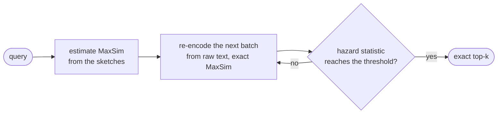

# ReCo: Recall-Guaranteed Multi-Vector Search Without Stored Vectors

This repository holds the code, results and run logs of the paper *Recall-Guaranteed Multi-Vector Search Without
Stored Vectors*. Every number, table and figure in the paper can be rebuilt from `results/` and checked against the
original run logs on a laptop in a few minutes, without a GPU, data or models.

The Python package is called `savemv`, the project's working name.

## What ReCo does

A multi-vector (late-interaction) index such as ColBERT stores one vector per token, which takes 28 to 48 times the raw
text on the BEIR corpora we study. ReCo stores no token vectors. For each document it keeps the raw text and a
centroid-bag sketch of 0.22 to 0.53 times the text, and it answers a query in three steps:

1. **Rank by sketch.** Estimate every document's MaxSim score from its sketch and order the candidates.
2. **Re-encode in batches.** Re-encode the next candidates from their raw text and score them exactly.
3. **Stop.** A learned hazard statistic decides when to stop. One threshold, set by conformal risk control, bounds
   the expected fraction of the exact top-k that is missed by δ, for queries exchangeable with the calibration queries.



## Results at a glance

| Setting | ReCo | Compared with |
|---|---|---|
| BEIR, 7 corpora: index size | 0.22–0.53× the raw text | ColBERT 28–48×, PLAID 4.0–6.7× |
| BEIR: nDCG@10 at δ = 0.01 | within −0.4 to +0.1 points of exact ColBERT, 99.8% on average, best on 6 of 7 corpora | PLAID 99.0%, other compressed indexes at most 97.2% |
| BEIR: stopping cost | fewest recomputations of 7 stopping rules in 11 of 13 query-level settings | FixedBudget, TA-Margin, Patience, ProbTopK, LAET, DARTH |
| MS MARCO, 8.8M passages | 0.87 GB index, 0.951 of the exact top-10 at δ = 0.05, MRR@10 of exact ColBERT | official PLAID index: 18.6 GB, at most 0.873 in every setting tried |
| LongMemEval, agent memory | 36 ms to retrieve with re-encoding on a GPU | 810 ms for a 4B reader to read the results |

These values are macros of `paper_artifacts/numbers.tex`, which the first command below regenerates.

## Check the paper in a few minutes

No GPU, data or models are needed. From the repository root:

```bash
pip install -r requirements/paper.txt

python scripts/paper/paper_assets.py results paper_artifacts   # rebuilds every number, table and figure of the paper
python tools/verify_logs.py                                    # compares the run logs with the results, value by value
python tools/verify_literals.py                                # recomputes the numbers written in the paper's prose
```

The three commands end with:

```
600 macros; tables: [... 13 tables ...]; figures: [... 9 figures ...]
mismatches: 0, results without a log line: 0
0 statement(s) failed
```

| Check | Outcome |
|---|---|
| `numbers.tex` and the 13 tables against the paper's sources | identical, byte for byte |
| The 9 plotted figures against the paper's | pixel-identical with matplotlib 3.10.8 and Times New Roman |
| Run logs against `results/` | 5,953 logged values, no mismatch |
| Numbers written in the prose | all 71 statements hold |
| Unit tests, `python -m unittest discover -s tests -t .` | 64 tests: 60 pass, 4 skip when the baseline models are not downloaded |

[docs/VERIFICATION.md](docs/VERIFICATION.md) describes each check and its limits.

## Try ReCo on a laptop

```bash
pip install -r requirements/base.txt
python -m savemv run --config configs/smoke_reco.yaml
```

The first run downloads SciFact and `answerai-colbert-small-v1` from Hugging Face. ReCo then encodes the first 1,000
documents on the CPU, builds sketches with 256 and 1,024 centroids, calibrates the stopping rule and measures online
search. It takes about four minutes on an 8-core laptop and writes `outputs/scifact_n1000/summary.md`. A line such as

```
K=1024 storage=0.079x | fixed R=191 | rank-aware R=195.2 recall=0.971 nDCG=0.9076 | strict R=534.9
```

reports the sketch size relative to the raw text, the documents recomputed per query, the recall of the exact top-10
and nDCG@10, which equals exact ColBERT's 0.9076 on this sample.

## Reproduce the experiments

[docs/EXPERIMENTS.md](docs/EXPERIMENTS.md) gives the command, the results folder and the logs for every table and
figure. In short:

| In the paper | Main entry point | Results |
|---|---|---|
| Exp-1 to Exp-3: quality, stopping rules, cascades (Tables IV–VI, Figs. 3–4) | `scripts/pipeline/run_paper.sh bench`, `scripts/stopping/stopping_baselines.py` | `results/beir`, `results/stopping_baselines` |
| Exp-4: MS MARCO against the official PLAID engine (Table VII) | `scripts/web_scale/run_msmarco.sh`, `scripts/official_baselines/run_plaid.sh` | `results/msmarco` |
| Exp-5: latency, throughput, construction, storage cost (Tables VIII–X, Fig. 5) | `run_paper.sh latency build`, `scripts/web_scale/run_throughput.sh` | `results/latency`, `results/build_cost`, `results/cost` |
| Exp-6: agent memory and question answering (Tables XI–XIII) | `run_paper.sh memory qa qa_local`, `scripts/efficiency/cpu_latency.py` | `results/memory`, `results/qa`, `results/cpu_latency` |
| Exp-7 to Exp-13: parameter study (Table XIV, Figs. 6–11) | `run_paper.sh bench scalability`, `scripts/stopping/param_study.py` | `results/beir`, `results/param_study`, `results/scalability` |
| Ablation (Table XV) | `run_paper.sh ablation` | `results/ablation` |

### Baselines

Baselines with public code run through it: PLAID through the official `colbert-ai` 0.2.22 engine and WARP through
[jlscheerer/xtr-warp](https://github.com/jlscheerer/xtr-warp). Methods reimplemented here are tested against their
originals: token pooling against PyLate, MUVERA encodings against the reference implementation, ConstBERT against its
official model code, and the encoder's tokenization against `transformers`. See
[THIRD_PARTY_NOTICES.md](THIRD_PARTY_NOTICES.md).

### Environments

The experiments ran on an Intel Xeon Gold 5218R with two RTX 3090 GPUs, Python 3.10, PyTorch 2.2.1 and CUDA 12.1. The
on-device numbers come from a laptop with an AMD Ryzen AI 7 H 350. The official engines pin their own dependencies, so
three environments are needed:

| Environment | Used by | Exact versions |
|---|---|---|
| `.venv` | ReCo and the baselines reimplemented here | `requirements/main.lock.txt` |
| `.venv_plaid` | official PLAID engine (`colbert-ai` 0.2.22) | `requirements/plaid.lock.txt` |
| `.venv_warp` | official WARP engine | `requirements/warp.lock.txt` |

`requirements/base.txt` lists the direct dependencies of `savemv`. Copy `env.example.sh` to `.env.sh` first, because the
run scripts source it. A full rerun takes days of GPU time, and the exact-score matrix of MS MARCO alone takes about
40 GB of disk.

### Data

Datasets are not redistributed here.

| Data | Source | Location |
|---|---|---|
| BEIR corpora | `mteb/<name>` on Hugging Face, downloaded on first use | `data/<name>/` |
| MS MARCO passages | passage collection in the MTEB layout (`corpus.jsonl`, `queries.jsonl`, `qrels/dev.tsv`) | `data/msmarco/` |
| LongMemEval-S | LongMemEval benchmark, cleaned release | `data/memory/longmemeval_s_cleaned.json` |
| LoCoMo | LoCoMo benchmark | `data/memory/locomo10.json` |

### Models

Models are not redistributed here. Each goes to `models/<name>/`.

| Model | Hugging Face |
|---|---|
| answerai-colbert-small-v1 | `answerdotai/answerai-colbert-small-v1` |
| colbertv2.0 | `colbert-ir/colbertv2.0` |
| ConstBERT | `pinecone/ConstBERT` |
| bge-small-en-v1.5, bge-base-en-v1.5 | `BAAI/bge-small-en-v1.5`, `BAAI/bge-base-en-v1.5` |
| splade-cocondenser-ensembledistil | `naver/splade-cocondenser-ensembledistil` |
| xtr-base-en | `google/xtr-base-en` |
| Qwen3-4B-Instruct-2507 | `Qwen/Qwen3-4B-Instruct-2507`, the on-device reader of the question-answering experiments |

The cloud reader of the question-answering experiments needs a DeepSeek API key in `$DEEPSEEK_API_KEY` or in
`~/.config/deepseek/api_key`.

The official WARP code is not included. Clone [jlscheerer/xtr-warp](https://github.com/jlscheerer/xtr-warp) into
`third_party/xtr-warp` and run `python scripts/official_baselines/patch_warp.py third_party/xtr-warp`, which only guards
its optional OpenVINO imports.

## Layout

```
savemv/                    the library
  reco/                    ReCo: sketch, estimator, inverted index, stopping rules, online engine
  baselines/               residual compression, token pooling, MUVERA, ConstBERT, BM25, SPLADE++, dense
  core/  encoders/  data/  exact MaxSim, codebooks, metrics, the ColBERT encoder, dataset loaders
  experiments/             BEIR benchmark, agent memory, question answering
configs/                   experiment configurations (paper_bench.yaml is the main one)
scripts/
  pipeline/                run_paper.sh runs the stages of the BEIR, memory and QA experiments
  stopping/                stopping-rule baselines, calibration on train queries, parameter study, ablation
  web_scale/               MS MARCO, throughput, inverted index, corpus-size study
  official_baselines/      the official PLAID and WARP engines, and the ConstBERT fidelity check
  efficiency/              construction cost, on-device latency, storage cost model
  paper/                   builds the numbers, tables and figures of the paper from results/
tests/                     unit tests, including comparisons with official implementations
results/                   the results the paper reads, one folder per experiment
logs/                      the run logs of those results, one folder per experiment
paper_artifacts/           numbers, tables and figures rebuilt from results/
requirements/              exact environments of the experiment server, and paper.txt for the checks above
tools/                     verify_logs.py checks logs against results, verify_literals.py the numbers in the prose
docs/EXPERIMENTS.md        for each table and figure: command, results and logs
docs/VERIFICATION.md       what was verified, and how
```

The ten largest result files are gzipped (`results/beir`, `results/beir_cv2`), and `scripts/paper/make_report.py` reads
both forms. Exploratory pilots, runs superseded by a later protocol, and intermediate artifacts such as encodings and
indexes are not included.

## Review of the theory and code

The theoretical results of the paper and the experimental code in this repository were reviewed in detail by two large
language models, Claude and ChatGPT. Each proof and derivation was checked step by step, including Proposition 1,
Theorems 1 and 2 with their corollaries, and the bound of the pooled variant ReCo-D. The code was compared with the
algorithms and the experimental settings described in the paper. No errors were found in the final versions of the
paper and the code. This review complements the checks above, which rebuild every number, table and figure of the paper
from `results/` and verify `results/` against the original run logs. Reports of any remaining issue are welcome through
the GitHub issue tracker.

## License

The code is released under the MIT License, see [LICENSE](LICENSE). The datasets, models and official baseline engines
it downloads or calls are not part of this repository and keep their own licenses.
